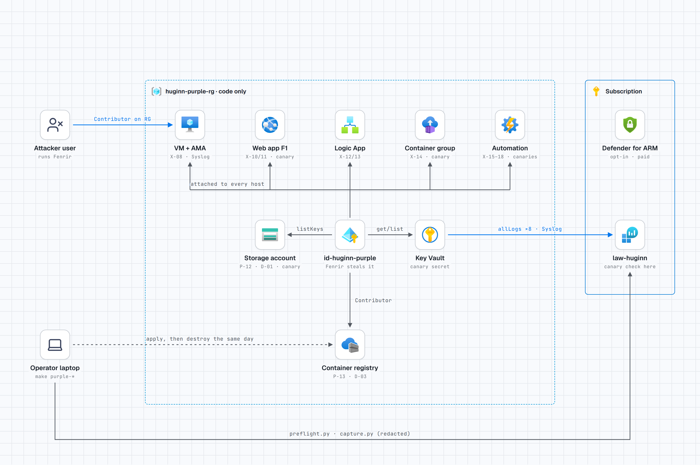
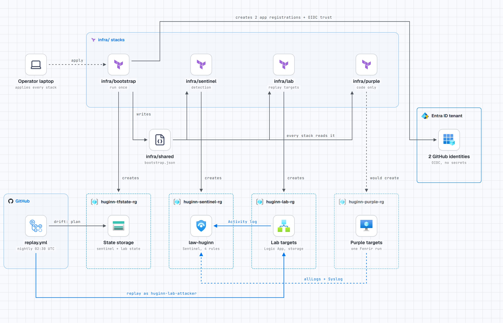

# Huginn

**Fenrir attacks Azure managed identities; Huginn proves Sentinel catches each logged step.**

Huginn is the defensive counterpart to [Fenrir](https://github.com/MarwenOnGit/fenrir), an Azure
security assessment tool for authorized tests and labs. Huginn is a set of Microsoft Sentinel
analytics rules for the actions Fenrir performs, deployed with Terraform, and proven every night
by replaying benign versions of those actions in a lab subscription and checking that the
expected alert appears.

> **Status (2026-11-04).** Four core rules are **validated**: each fired in two back-to-back
> benign replays with one alert per event. Everything else is a draft. The dated, honest record
> is [docs/STATUS.md](docs/STATUS.md); the coverage matrix is
> [docs/FENRIR-MAPPING.md](docs/FENRIR-MAPPING.md).

<picture>
  <source media="(prefers-color-scheme: dark)" srcset="docs/diagrams/huginn-azure-dark.png">
  
</picture>

What is deployed today. The blue path is the nightly proof: a GitHub Actions job signs in with
OIDC as the lab attacker, performs a benign Fenrir-shaped action on fresh lab resources, the
Activity log carries the event to Log Analytics, and Sentinel must raise the alert. Fenrir itself
causes the same ARM actions. Interactive version: [docs/diagrams/huginn-azure.html](docs/diagrams/huginn-azure.html).

## What Huginn can and cannot see

Fenrir makes no writes. Its entire `AzureActivity` footprint is six POST actions: VM Run Command
(X-08), App Service publishing credentials (X-10), Logic App callback URL (X-13), Container
Instances exec (X-14), storage `listKeys` (P-12) and ACR `listCredentials` (P-13).

**Blind spots, stated plainly**
- **ARM reads are not logged** in `AzureActivity`. Fenrir's whole `enumerate` phase, `post-exploit`
  without dump flags, and the Automation Account path (X-15 to X-18: reading runbook source,
  variables and credential names) leave no trace in Sentinel.
- **Graph reconnaissance** (E-01 to E-07, X-06) is visible only with Entra ID P1/P2 and
  `MicrosoftGraphActivityLogs`. This tenant has no P1/P2.
- **What happens on a host** after Run Command or a container exec is not in control-plane logs.
  Huginn sees that a command was run, not what it did. The command text is not logged either
  (lab evidence X-08).

## Rules by tier

| Tier | Rule | Fenrir ops | Status |
|---|---|---|---|
| Core (`AzureActivity`, no licence) | `logicapp-callback-listed` | X-13 | **validated** 2026-11-03 |
| | `storage-keys-listed` | P-12 | **validated** 2026-11-03 (branch C: new caller-account pair) |
| | `fenrir-chain` | X-08, X-10, X-13, X-14, P-12, P-13 | **validated** 2026-11-03 (multi-stage branch) |
| | `vm-runcommand-by-user` | X-08 | **validated** 2026-11-03 |
| | `appservice-publish-creds` | X-10 | draft (opt-in lab batch after 11 November) |
| | `aci-exec` | X-14 | draft (opt-in lab batch) |
| | `acr-admin-creds-listed` | P-13 | draft (opt-in lab batch) |
| Identity (manual purple-team run) | `mi-control-plane-new-ip` | P-12, P-13 as the managed identity | draft, deployable (`AzureActivity` only) |
| | `mi-signin-anomaly` | host side of X-08, X-11 | written, **not deployable** (needs P1/P2) |
| | `devicecode-azure-mgmt-signin` | A-02, A-04 | written, **not deployable** (needs P1/P2) |
| | `graph-directory-recon` | E-01 to E-07, X-06 | written, **not deployable** (needs P1/P2) |
| Beyond Fenrir | `rbac-self-assignment`, `uai-attached-to-host`, `automation-runbook-run` | none | drafts. Next steps an operator would take after Fenrir reports the opportunity; Fenrir does not trigger them. |

Measured time to alert: 5 to 17 minutes (ingestion of `AzureActivity` takes 3 to 10 minutes,
plus the 5-minute rule schedule and Sentinel's 5-minute run delay).

## How it is tested

| Loop | When | Azure | What |
|---|---|---|---|
| [`ci.yml`](.github/workflows/ci.yml) | every push | no | static rule tests, KQL syntax (Microsoft's `Kusto.Language` parser), `terraform fmt`/`validate`, tflint, checkov |
| [`replay.yml`](.github/workflows/replay.yml) | nightly 02:30 UTC and on demand | yes | drift check (deployed rules = git), benign replays as the lab attacker on **fresh** resources, alert validation with time-to-alert, cleanup |
| [`evidence.yml`](.github/workflows/evidence.yml) | on demand | yes | one benign action per Fenrir operation, to capture the real log rows (`lab-evidence/`) |
| [Purple team](docs/PURPLE-TEAM.md) | manual | yes | a real Fenrir run against a disposable, fully logged environment (`infra/purple`): every table it touched is captured, canary secrets show which logs a stolen secret reaches |

Details: [docs/TESTING.md](docs/TESTING.md). Design: [docs/ARCHITECTURE.md](docs/ARCHITECTURE.md).
Interview walkthrough: [docs/DEMO.md](docs/DEMO.md).

### CI: static checks, no Azure

<picture>
  <source media="(prefers-color-scheme: dark)" srcset="docs/diagrams/huginn-ci-dark.png">
  
</picture>

None of the five jobs signs in to Azure or reads a secret, so pull requests from any branch are
safe to test. The KQL job also proves the parser still rejects broken fixtures.

### Replay: act like the attacker, then prove the alert

<picture>
  <source media="(prefers-color-scheme: dark)" srcset="docs/diagrams/huginn-replay-dark.png">
  
</picture>

Four jobs, two identities, no Terraform apply. The drift job signs in as the deploy identity and
runs `terraform plan` on the Sentinel stack; any non-empty plan means the deployed rules no longer
match git and the run stops before a single replay, so every nightly result is a proof of the
committed rules. The replay job then switches to the lab attacker and acts on freshly created
resources, because two of the rules alert only on a **new** (caller, resource) pair and would
correctly fall silent on the second night against a reused target. A uniquely named resource per
run keeps the pair new. Cleanup deletes them, and validation polls `SecurityAlert` until each
expected alert lands, recording the time to alert per rule.

### Evidence: what Azure really logs

<picture>
  <source media="(prefers-color-scheme: dark)" srcset="docs/diagrams/huginn-evidence-dark.png">
  
</picture>

Started by hand with a list of operations. The job performs each one once as the lab attacker, then
`scripts/evidence/capture.py` reads the resulting rows from Log Analytics, writes a redacted JSON
file per operation to `lab-evidence/` and keeps the raw rows git-ignored. Those committed rows are
the ground truth each rule is written against: the exact `OperationNameValue`, which fields are
populated, and which operations leave no row at all. The blind spots in
[docs/FENRIR-MAPPING.md](docs/FENRIR-MAPPING.md) are measured here, not assumed.

### Purple team: a real Fenrir run

<picture>
  <source media="(prefers-color-scheme: dark)" srcset="docs/diagrams/huginn-purple-dark.png">
  
</picture>

The diagram above is the run flow. The resource and logging topology of the stack itself, with the
user-assigned identity attached to every host and the `allLogs` diagnostic setting on eight
resources plus Syslog, is in the per-stack diagram:

<picture>
  <source media="(prefers-color-scheme: dark)" srcset="docs/diagrams/huginn-purple-stack-dark.png">
  
</picture>

Written, not yet applied, and never run by CI. One apply stands up `huginn-purple-rg` with one of
every resource type Fenrir touches (VM for X-08, web app for X-10/X-11, Logic App for X-13,
container group for X-14, Automation Account for X-15 to X-18, storage for P-12/D-01, registry for
P-13/D-03, Key Vault for E-27), each sending the `allLogs` category group to `law-huginn` and the VM
streaming all Syslog facilities through the Azure Monitor Agent. The attacker is a dedicated
low-privilege user, Contributor on this one resource group only; the user-assigned identity on every
host is the shape Fenrir extracts tokens for. A `HUGINN-CANARY-` value sits where each real secret
would, so a canary found in a log proves a stolen secret reached it. `make purple-preflight` proves
every log source reaches `law-huginn` before Fenrir starts and will not report `READY` until
data-plane rows land; `make purple-capture` collects every row that mentions the run's identities or
IP (`union *`), redacts it, and reports any table that contains a canary. This turns the blind-spot
claims into measured results, one run at a time.
Steps: [docs/PURPLE-TEAM.md](docs/PURPLE-TEAM.md), design: [ADR 0008](docs/adr/0008-purple-environment.md).

## How the stacks fit together

<picture>
  <source media="(prefers-color-scheme: dark)" srcset="docs/diagrams/huginn-stacks-dark.png">
  
</picture>

Four stacks, applied in order. `infra/bootstrap` is applied once by a person: it creates the state
storage, the resource groups and the two GitHub OIDC app registrations (one for `main`, one scoped
to the `lab-replay` environment), and writes `infra/shared/bootstrap.json`, which every other stack
reads. `infra/sentinel` holds the detection side (workspace, Activity log connector, the
`HuginnActivity` function, the watchlist and the rules) and is applied by hand but planned nightly
by the drift check. `infra/lab` holds the Fenrir-shaped replay targets that the replay workflow acts
on as `huginn-lab-attacker`. `infra/purple` is a disposable, fully logged target that only a person
ever applies. Each stack has its own per-stack diagram in `docs/diagrams/` (`huginn-bootstrap`,
`huginn-sentinel`, `huginn-lab`, `huginn-purple-stack`).

### Stack reference

| | `infra/bootstrap` | `infra/sentinel` | `infra/lab` | `infra/purple` |
|---|---|---|---|---|
| Purpose | foundation: state, resource groups, identities | detection: workspace, Sentinel, rules | targets for the replays and evidence runs | disposable target for one real Fenrir run |
| State | local, git-ignored | remote, `sentinel.tfstate` | remote, `lab.tfstate` | remote, `purple.tfstate` |
| Applied by | a person, once (Owner and Global Administrator) | a person, after a reviewed plan | a person, after a reviewed plan | a person, for one run, destroyed the same day |
| In CI | fmt, validate, tflint, checkov | the same, plus the nightly drift plan | the same, plus the nightly drift plan; replays act on it | fmt, validate, tflint, checkov only |
| Reads | nothing from the repo | `bootstrap.json`, `detections/`, `functions/`, `watchlists/` | `bootstrap.json` | `bootstrap.json`, the `law-huginn` workspace |
| Writes to the repo | `infra/shared/bootstrap.json`, `infra/shared/backend.hcl` | nothing | nothing | nothing |

Order: bootstrap, then sentinel, then lab. Purple is optional and needs sentinel, because it sends
its logs to `law-huginn`. Every stack after bootstrap stops at plan time if `bootstrap.json` is
missing. `make destroy` goes the other way: purple (if initialised), lab, sentinel; bootstrap is
kept.

#### `infra/bootstrap`

- **Creates:** the resource groups `huginn-tfstate-rg`, `huginn-sentinel-rg` and `huginn-lab-rg`;
  the state storage account and container; two app registrations with OIDC federated credentials
  and no secrets:
  - `huginn-github-deploy`: trusted for the `main` branch. Contributor on the Sentinel and lab
    resource groups, Monitoring Contributor on the subscription (Activity log setting only), blob
    access to the state container. Runs `terraform plan` in CI, never `apply`.
  - `huginn-lab-attacker`: trusted for jobs in the `lab-replay` GitHub environment. Contributor on
    `huginn-lab-rg` only, and never in the watchlist.
- **Inputs:** tenant and subscription IDs, region, the GitHub repository with its numeric owner
  and repository IDs, the replay environment name.
- **Not created here:** the `lab-replay` environment and the repository variables in GitHub (see
  Quick start).
- **Re-apply when:** the repository is renamed or moved, because the OIDC subjects contain it.
- **Docs:** [ADR 0003](docs/adr/0003-oidc-identities-and-state.md),
  [infra/shared/README.md](infra/shared/README.md).

#### `infra/sentinel`

- **Creates:** the workspace `law-huginn` (0.5 GB/day cap, 30-day retention) with Sentinel; the
  subscription Activity log setting `huginn-activity-to-law`; the optional Entra setting
  `huginn-entra-to-law`; the workspace function `HuginnActivity`; the watchlist
  `HuginnTrustedAutomation`; one scheduled rule per `detections/*/*/rule.yaml` that is
  `deployable` and listed in `enabled_rules`.
- **Variables you change** (in `huginn.auto.tfvars.json`): `enabled_rules`, `disabled_rules`,
  `trusted_operators` (people who run Terraform locally, each with an expiry). Also
  `daily_quota_gb` (raise it for a purple-team run) and `enable_entra_logs` (needs Entra ID P1/P2
  and a Global or Security Administrator).
- **Outputs:** `deployed_rules` and `skipped_rules`, so a plan shows which rule folders were left out.
- **Good to know:** Terraform overwrites rule edits made in the portal. Each rule's ID is a GUID
  derived from its rule ID, so renaming a rule never recreates it.
- **Docs:** [ADR 0001](docs/adr/0001-detections-as-code.md),
  [ADR 0006](docs/adr/0006-licence-tiers.md), [ADR 0007](docs/adr/0007-watchlist-not-client-app-exclusions.md),
  [ARCHITECTURE.md](docs/ARCHITECTURE.md).

#### `infra/lab`

- **Creates, always on:** a user-assigned identity, a Logic App with an HTTP trigger (X-13), a
  storage account (P-12), and the VNet, subnet and NSG for the X-08 VM. The VM itself is created
  and deleted by each run, not by Terraform.
- **Opt-in:** `enable_appservice` (F1 plan and web app, X-10), `enable_aci` (container group,
  X-14), `enable_acr` (registry, P-13). All off by default.
- **Who acts on it:** `evidence.yml` uses the Logic App and storage account it creates.
  `replay.yml` creates fresh, uniquely named resources next to them on every run, so the
  "new pair" rules see a new pair each time.
- **Docs:** [ADR 0005](docs/adr/0005-replays-fresh-resources-and-dedup.md),
  [COST.md](docs/COST.md), [TESTING.md](docs/TESTING.md).

#### `infra/purple`

- **Creates:** its own resource group `huginn-purple-rg`; a VM (Azure Monitor Agent and Syslog), a
  web app, a Logic App, a container group, an Automation account, a storage account, a registry
  and a Key Vault; one user-assigned identity on every host; canary secrets in the storage
  account, Key Vault and Automation account; `allLogs` diagnostic settings on every resource,
  sent to `law-huginn`.
- **Attacker:** a dedicated Entra user that you create yourself and pass as `attacker_object_id`.
  The stack only grants it Contributor on `huginn-purple-rg`.
- **Opt-in:** `enable_defender_arm` turns on Defender for Resource Manager for the whole
  subscription. It is paid after the trial, so turn it off after the run.
- **Lifecycle:** written, not yet applied. Apply, run, capture (`make purple-capture`), then
  `make purple-destroy` the same day.
- **Docs:** [ADR 0008](docs/adr/0008-purple-environment.md), [PURPLE-TEAM.md](docs/PURPLE-TEAM.md).

## Quick start

Prerequisites: Terraform >= 1.6, Azure CLI with the `log-analytics` extension, Python 3.11+,
GitHub CLI, tflint, checkov. Owner on the subscription and Global Administrator on the tenant
(for the bootstrap only).

```bash
make test && make lint                  # local checks, no Azure

# 1. Once, as a person: state storage, resource groups, the two OIDC identities
make init STACK=bootstrap && make plan STACK=bootstrap   # review, then:
make apply STACK=bootstrap              # writes infra/shared/bootstrap.json and backend.hcl

# 2. Sentinel (workspace, Activity log, function, watchlist, rules) and the lab
make init STACK=sentinel && make plan STACK=sentinel && make apply STACK=sentinel
make init STACK=lab && make plan STACK=lab && make apply STACK=lab
```

Then, in GitHub: create the environment `lab-replay` and the repository variables
`AZURE_TENANT_ID`, `AZURE_SUBSCRIPTION_ID`, `AZURE_DEPLOY_CLIENT_ID`, `AZURE_ATTACKER_CLIENT_ID`
(values in `infra/shared/bootstrap.json`; none of them is a secret). Run the `replay` workflow.

Rules are deployed per rule: list them in `enabled_rules` in
[`infra/sentinel/huginn.auto.tfvars.json`](infra/sentinel/huginn.auto.tfvars.json). Adding a rule
folder never needs a Terraform change.

## Cost and teardown

About 0 USD per month always on (Activity log ingestion is free; no always-on compute). A nightly
replay with the VM costs well under 1 US cent. Details: [docs/COST.md](docs/COST.md).

```bash
make destroy    # removes purple (if initialised), the lab and the Sentinel stack (asks first); bootstrap is kept (~0 cost)
```

## Naming

The project is **Huginn**, the same spelling as the deployed identifiers: the workspace function
`HuginnActivity`, the watchlist `HuginnTrustedAutomation`, the `huginn-*` resource groups and app
registrations, and the Sentinel rule titles ("Huginn - ..."). One exception is deliberate: the
seed URL that `infra/sentinel/rules.tf` and `tests/validate_alert.py` hash into each rule's GUID
keeps the old repository name `MarwenOnGit/Huggin`, because changing it would recreate every rule.

## Repository

```
infra/bootstrap   state storage, resource groups, GitHub OIDC identities (applied once, by a person)
infra/sentinel    workspace, Sentinel, Activity log connector, function, watchlist, rules
infra/lab         Fenrir-shaped targets: Logic App, storage, identity, VM network
infra/purple      disposable purple-team environment: every Fenrir target, every log source on (manual)
detections/       one folder per rule: rule.kql, rule.yaml, README.md, replay.sh (CI rules)
functions/        HuginnActivity.kql (shared normalisation)
watchlists/       HuginnTrustedAutomation.csv
scripts/          replay and evidence helpers
tests/            static tests, KQL syntax check, alert validation
lab-evidence/     real AzureActivity rows from lab runs, secrets redacted
docs/             review docs, status, architecture, testing, cost, demo, ADRs
docs/diagrams/    the diagrams above: self-contained HTML source, light and dark PNGs
blog/             draft write-up with screenshots from the lab
```

## Roadmap

- **14-day baselines at 5-minute speed.** Sentinel requires hourly runs for lookbacks of 2 days or
  more, so the fast "new pair" rules use a 47-hour baseline today. Plan: a daily job writes the
  last 14 days of (caller, resource) pairs to a `HuginnKnownPairs` watchlist that the fast rules
  read ([ADR 0005](docs/adr/0005-replays-fresh-resources-and-dedup.md), option C).
- Opt-in lab batch and validation for X-10, X-14, P-13 (rules 5 to 7).
- First [purple-team run](docs/PURPLE-TEAM.md) on `infra/purple` (written, not yet applied): measure every blind spot instead of citing documentation; identity tier with an Entra ID P2 trial.
- Defender XDR correlation; Logic Apps response playbooks (for example rotate a storage key after
  `storage-keys-listed`); data-plane rules on `StorageBlobLogs` and ACR logs (D-01 to D-03);
  hunting queries for the enumerate phase; a Bastion landing zone for the lab.
