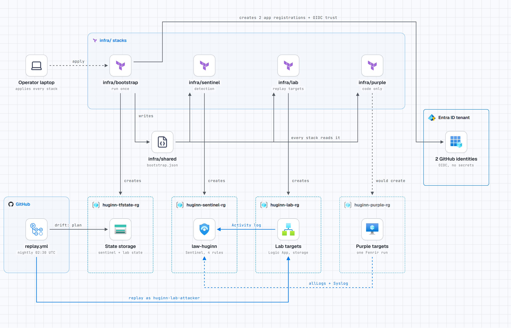
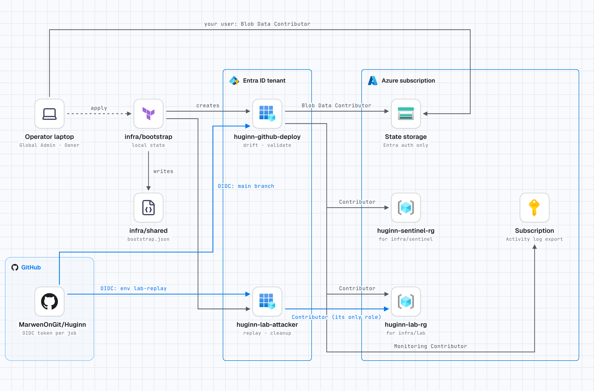
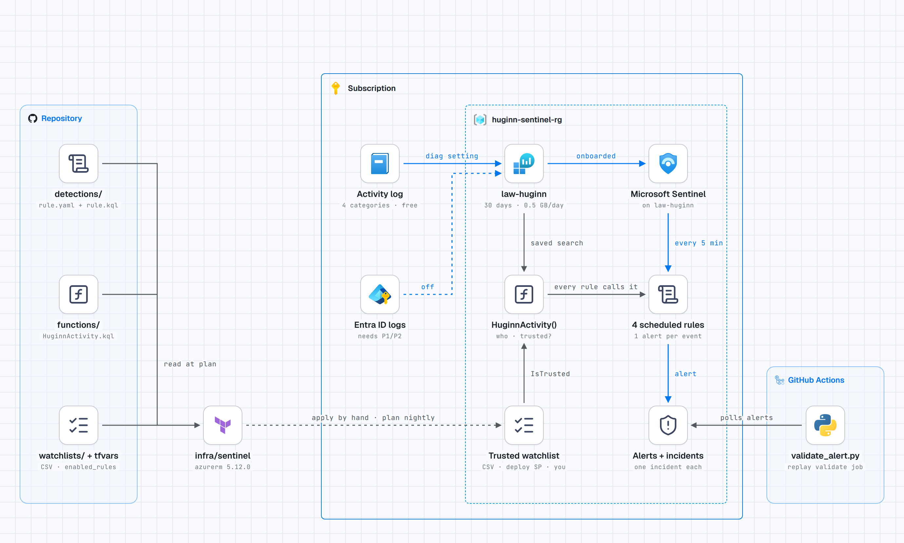
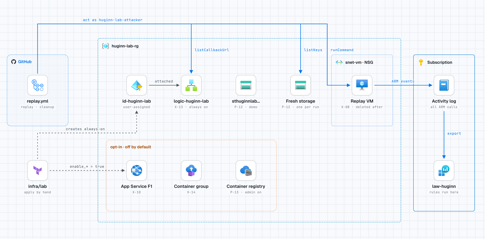
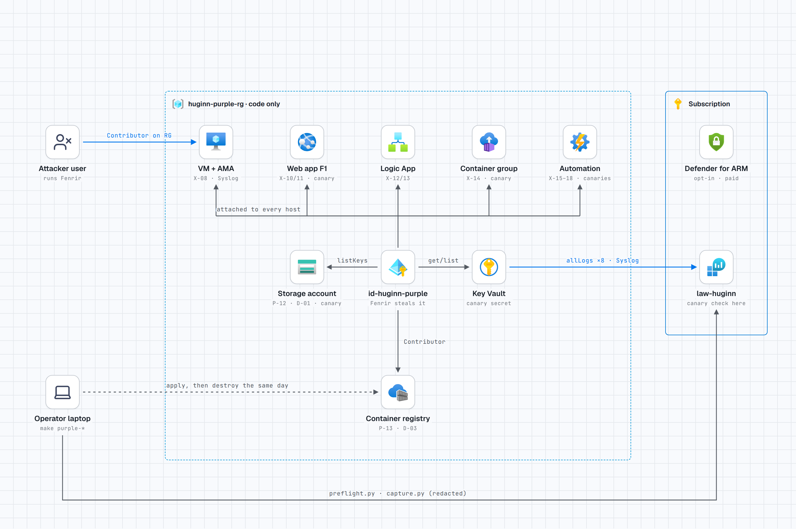

# Proving Sentinel catches an Azure managed-identity attack, every night

> **Draft.** Facts and numbers come from [docs/STATUS.md](../docs/STATUS.md) and
> [docs/TESTING.md](../docs/TESTING.md) as of 2026-11-04. Edit the voice and the framing freely
> before publishing; keep the numbers in sync with those files.

I wrote [Fenrir](https://github.com/MarwenOnGit/fenrir), a tool that assesses Azure managed
identities for authorized tests. Huginn is the other side: Microsoft Sentinel rules for each step
Fenrir takes that Azure logs, plus a lab that proves every night that the rules still fire.

<picture>
  <source media="(prefers-color-scheme: dark)" srcset="../docs/diagrams/huginn-azure-dark.png">
  
</picture>

The blue path is the whole proof loop. A GitHub Actions job signs in with OIDC as a dedicated lab
attacker (no stored secret, a federated credential scoped to one environment), performs a benign
Fenrir-shaped action on freshly created lab resources, and the Activity log carries that action to
Log Analytics, where Sentinel must raise the matching alert. Fenrir itself produces the same ARM
operations, so a rule proven against the replay is proven against the tool. State lives in its own
`huginn-tfstate-rg`, and the one-time bootstrap (state storage, resource groups, the two OIDC
identities) is applied by a person, never by CI. An interactive version of this diagram is in
[docs/diagrams/huginn-azure.html](../docs/diagrams/huginn-azure.html).

## What there is to detect

Fenrir makes no writes. In `AzureActivity`, its whole footprint is six POST actions: VM Run
Command (X-08), App Service publishing credentials (X-10), Logic App callback URL (X-13),
container exec (X-14), storage `listKeys` (P-12) and registry `listCredentials` (P-13).

Just as important is what is **not** there. ARM reads are not logged, so Fenrir's whole
enumeration phase is invisible. Graph reconnaissance needs Entra ID P1/P2, which my tenant does
not have. And after a Run Command, Azure records that a command ran, not which one (lab evidence
X-08). The README states these blind spots up front, because a detection project that hides them
is not worth much.

## Detections as code

Each rule is a folder: `rule.kql`, `rule.yaml` (frequency, lookback, entities, MITRE, status) and
a README. Terraform discovers the folders, so adding a rule never needs a Terraform edit.

The rule description links back to its source folder, and the query in Sentinel starts with the
same "Validated" header as the file in git:

## How it is built: four Terraform stacks

<picture>
  <source media="(prefers-color-scheme: dark)" srcset="../docs/diagrams/huginn-stacks-dark.png">
  
</picture>

The work splits into four Terraform stacks, each applied in a different way for a reason.

**`infra/bootstrap`** is applied once, by a person, never by CI. It creates the Terraform state
storage, the resource groups, and the two GitHub OIDC app registrations that let the workflows sign
in with no stored secret: one trusts the `main` branch, the other is scoped to the `lab-replay`
environment. It writes `infra/shared/bootstrap.json`, the file every other stack reads for the tenant
and subscription IDs.

<picture>
  <source media="(prefers-color-scheme: dark)" srcset="../docs/diagrams/huginn-bootstrap-dark.png">
  
</picture>

**`infra/sentinel`** is the detection side: the Log Analytics workspace, the Activity log connector,
the `HuginnActivity` function that normalises rows and checks the trusted-automation watchlist, and
the rules themselves. It is applied by hand, but the nightly drift job runs `terraform plan` against
it, so the deployed rules can never silently drift from git.

<picture>
  <source media="(prefers-color-scheme: dark)" srcset="../docs/diagrams/huginn-sentinel-dark.png">
  
</picture>

**`infra/lab`** holds the Fenrir-shaped replay targets the nightly job acts on as
`huginn-lab-attacker`: the Logic App whose callback URL is listed (X-13), the storage account whose
keys are listed (P-12), the VM for Run Command (X-08), and the managed identity attached to a host.
Their ARM events export to the same workspace.

<picture>
  <source media="(prefers-color-scheme: dark)" srcset="../docs/diagrams/huginn-lab-dark.png">
  
</picture>

The fourth stack, `infra/purple`, is the disposable target covered below.

## Every push: CI without Azure

<picture>
  <source media="(prefers-color-scheme: dark)" srcset="../docs/diagrams/huginn-ci-dark.png">
  
</picture>

`ci.yml` runs with no Azure login and no secrets, in five parallel jobs. Static tests on every rule
folder assert the things a human reviewer forgets: that `rule.yaml`'s `Frequency` matches the
`ago()` window in the KQL, that every entity the query projects is mapped, that the MITRE tactic is
set. A KQL syntax check parses each query with Microsoft's own `Kusto.Language` parser, the same
grammar Sentinel uses, so a typo fails locally instead of at deploy time. `terraform fmt` and
`validate` run across all four stacks, then tflint and checkov in two passes. The KQL job also runs
the parser against deliberately broken fixtures, so a check that can never fail cannot hide a
regression.

## Every night: replay, then check for the alert

<picture>
  <source media="(prefers-color-scheme: dark)" srcset="../docs/diagrams/huginn-replay-dark.png">
  
</picture>

`replay.yml` runs four jobs with two separate identities. First a **drift** job signs in as the
deploy identity and runs `terraform plan` against the Sentinel stack: any non-empty plan means the
rules in Azure no longer match git, and the run stops before a single replay, so the nightly proof
is always a proof of the committed rules and nothing else. Then the **replay** job switches to the
dedicated lab attacker and performs benign versions of Fenrir's actions on **freshly created** lab
resources. A **cleanup** job deletes them, and a **validation** job polls `SecurityAlert` until each
expected alert appears, recording the time to alert for every rule.

Why fresh resources? Two of the rules alert on a **new** (caller, resource) pair. Replay the same
caller against the same Logic App every night and, from the second night on, the rule correctly
stays silent, and the build turns red for the wrong reason. Each replay creates a uniquely named
resource, so the pair is new every time. The test of that fix is two replays back to back: both
must be green.

## Evidence: the log rows the rules are written from

<picture>
  <source media="(prefers-color-scheme: dark)" srcset="../docs/diagrams/huginn-evidence-dark.png">
  
</picture>

A detection is only as honest as the log row it is written against. `evidence.yml` is started by
hand with a list of Fenrir operations. It performs each one once as the lab attacker, then
`scripts/evidence/capture.py` reads the resulting rows from Log Analytics and writes a redacted JSON
file per operation into `lab-evidence/`, with the raw rows kept git-ignored. Those committed rows are the
ground truth every rule is built from: the exact `OperationNameValue`, which fields are populated,
and, just as important, which operations leave **no** row at all. That is how the blind spots in the
coverage matrix became measured facts rather than assumptions, and it is where the first bug came
from.

## The bug the lab found: two alerts for one event

My first deployed rules followed Microsoft's sample and selected new rows with
`ingestion_time() > ago(lookback)`. The first green replay raised **2 alerts per event**, and 3
for the chain rule:

In a scheduled rule, `now()` is the window end, but Sentinel runs the query about 5 minutes later.
A row ingested in that gap counted as new in two runs. The fix is an upper bound,
`ingestion_time() <= now()`. A static test now checks that the KQL `Frequency` matches
`rule.yaml`.

A second trap: one request writes several rows that can be ingested minutes apart. One Run Command
call produced three rows (Start, Accept, Success) with one `CorrelationId`:

The rules that aggregate now treat a request as new once, when its first row lands. After both
fixes, two back-to-back replays fired every rule with exactly one alert per event.

## What the analyst sees

Entities are mapped, so the case graph links the caller to the resource it touched:

## Purple team: one real Fenrir run, every log source on

The replays are deliberately narrow. Each one performs a single action, as a service principal, and
never requests a managed-identity token, so they cannot settle the harder questions: is Fenrir's
whole `enumerate` phase really invisible, does a stolen secret ever surface in a log, is
`Claims_d.xms_mirid` present on a managed identity's `AzureActivity` rows? The purple-team
environment exists to answer those by measurement, from one real Fenrir run in a place built to be
thrown away.

<picture>
  <source media="(prefers-color-scheme: dark)" srcset="../docs/diagrams/huginn-purple-dark.png">
  
</picture>

<picture>
  <source media="(prefers-color-scheme: dark)" srcset="../docs/diagrams/huginn-purple-stack-dark.png">
  
</picture>

`infra/purple` is a separate Terraform stack, applied and destroyed by a person for a single run. CI
lints it but never applies it, and the nightly drift check ignores it. One apply stands up its own
`huginn-purple-rg` holding one of **every resource type Fenrir touches**, each mapped to the Fenrir
operations it answers:

| Resource | Fenrir operations |
|---|---|
| Linux VM with a user-assigned identity | X-08 (Run Command), host side of token theft |
| Linux web app with SCM basic auth on | X-10 / X-11 (publishing credentials, Kudu) |
| Logic App with an HTTP trigger | X-12 / X-13 (callback URL) |
| Container group (idle busybox) | X-14 (container exec) |
| Automation Account: runbook, variable, credential | X-15 to X-18 (runbook source, variables, credential names) |
| Storage account and blob | P-12 / D-01 (`listKeys`, blob data) |
| Container registry with admin user | P-13 / D-03 (`listCredentials`, image pull) |
| Key Vault | E-27 (secret read) |

Every resource with resource logs sends the `allLogs` category group to `law-huginn`, the VM streams
all Syslog facilities through the Azure Monitor Agent with a data collection rule, the subscription
Activity log is already wired in, and two sources are opt-in: Entra ID sign-in and Graph logs (an
Entra P1/P2 trial) and Defender for Resource Manager, the only Microsoft source that analyses ARM
traffic beyond the Activity log. The aim is to leave Fenrir nowhere to act that is not watched.

**Canaries make leaked secrets visible.** A random value with the fixed prefix `HUGINN-CANARY-` sits
where a real secret would: the runbook source, an Automation variable and credential, a Key Vault
secret, a blob, an app setting, a container environment variable. After the run, the capture script
flags every table that contains that prefix. A canary in a log means a stolen secret reached that
log, so the environment measures not just which actions are detectable but which exfiltrated secrets
end up in telemetry a defender can hunt on.

**Capture by indicator, not by table.** `scripts/purple/capture.py` does not query the tables you
expect. It runs `union *` for every row that mentions the run's identities or the attacker's IP, so
telemetry turns up in tables nobody predicted. It then redacts: the attacker IP becomes
`INDICATOR_IP_n`, and canaries, keys and tokens are stripped before anything is written to
`lab-evidence/purple/<run>/`.

**A preflight gate stops a wasted run.** The identities are shaped like the real target: a
user-assigned identity on every host (exactly what Fenrir extracts tokens for) with only Reader,
`Storage Account Key Operator` and `Storage Blob Data Reader`, and a dedicated low-privilege attacker
user that is Contributor on this one resource group and nothing else. Before any Fenrir command runs,
`make purple-preflight` proves every diagnostic setting reaches `law-huginn` and that data-plane rows
are actually landing; it will not report `READY` until they do. The stack is written and reviewed,
and the first run is the next step on the roadmap.

## Numbers

- **Validated rules:** 4 (`logicapp-callback-listed`, `storage-keys-listed`, `fenrir-chain`,
  `vm-runcommand-by-user`), each in two back-to-back replays on 2026-11-03.
- **Time to alert:** 5 to 17 minutes. `AzureActivity` takes 3 to 10 minutes to ingest; the 5-minute
  schedule and Sentinel's 5-minute run delay add the rest.
- **Cost:** about 0 USD per month always on (Activity log ingestion is free), and well under
  1 US cent per nightly replay with the VM.

## What's next

The remaining core rules (X-10, X-14, P-13) need an opt-in lab batch. The identity tier needs an
Entra ID P2 trial and a real Fenrir run. There is also a way to keep a 14-day baseline at 5-minute
speed: Sentinel caps 5-minute rules below a 2-day lookback, so a daily job would write known
(caller, resource) pairs to a watchlist. Code and docs:
[github.com/MarwenOnGit/Huginn](https://github.com/MarwenOnGit/Huginn).
